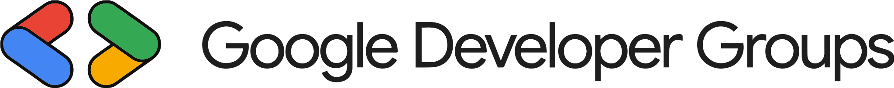

<p align="center">
  
</p>

<h1 align="center">GDG on Campus · UT Dallas</h1>

<p align="center">A home for the chapter. A starting point for your next project.</p>

<p align="center">
  <a href="https://www.gdgutd.com"><strong>Explore the website ↗</strong></a>
  &nbsp; · &nbsp;
  <a href="https://www.gdgutd.com/sprints">Discover SPRINT</a>
  &nbsp; · &nbsp;
  <a href="https://www.gdgutd.com/apply">Find an opportunity</a>
</p>

<p align="center">
  
  
  
  
</p>


## A community you can build with

GDG on Campus at UT Dallas brings students together to explore technology, share what they know, and turn ideas into working projects. Whether someone is attending their first workshop or preparing to mentor a team, this website helps them find a way in.

It connects the public face of the chapter with the practical work behind it: discovering events, exploring SPRINT, applying for opportunities, and keeping up with application decisions.

**The goal is simple: make it easier to take part.**

## What’s inside

| For the community | For applicants and organizers |
| --- | --- |
| **Meet the chapter** — Learn about GDG UTDallas, its officers, and its community. | **Your own dashboard** — Manage your profile, save application drafts, and track published decisions. |
| **Find your next event** — Browse upcoming sessions and RSVP on the official GDG chapter platform. | **A connected application process** — Apply for officer roles or SPRINT opportunities through one portal. |
| **Explore SPRINT** — Discover the eight-week mentored project program and see moments from past and current cohorts. | **Tools for application staff** — Review submissions, stage and publish decisions, manage mentee RSVPs, and export applications. |

### SPRINT: from an idea to a presentation

Small teams. Regular mentor support. Eight weeks of building something together.

The SPRINT experience introduces the program, shares chapter photography in a moving gallery, and connects prospective participants to available applications. Accepted mentees can respond to their offer through the dashboard.

[Explore the SPRINT program →](https://www.gdgutd.com/sprints)

## Built with

| Layer | Technology | What it does |
| --- | --- | --- |
| Website | Next.js 16 · React 19 · TypeScript | Public pages, member dashboards, and the staff portal |
| Styling | Tailwind CSS 4 · custom CSS | GDG colors, responsive layouts, and interaction states |
| Accounts & data | Supabase Auth · PostgreSQL | Member accounts, profiles, applications, and access controls |
| Background work | Supabase Edge Functions · Cron | Email requests, application notifications, and bounded delivery retries |
| Transactional email | Brevo | Account recovery and application updates |
| Hosting | Vercel | Website builds and deployment |
| Checks | ESLint · Node.js tests · PGlite · GitHub Actions | Code checks and isolated database regression tests |

## Run it locally

Use **Node.js 22** (see [`.nvmrc`](./.nvmrc)) and **npm 10 or newer**.

```bash
npm ci
cp .env.example .env.local
```

Fill in these values in `.env.local`:

| Variable | Purpose |
| --- | --- |
| `NEXT_PUBLIC_SUPABASE_URL` | Your Supabase project URL |
| `NEXT_PUBLIC_SUPABASE_PUBLISHABLE_KEY` | Your project’s browser-safe publishable key |
| `NEXT_PUBLIC_SITE_URL` | `http://localhost:3000` for local development |
| `PASSWORD_RECOVERY_SECRET` | A private signing secret for short-lived password recovery authorization |

Generate a recovery secret with `openssl rand -hex 32`, then paste its value into the server-only variable. Keep `.env.local` private.

Use a development Supabase project with the schema in [`supabase/migrations`](./supabase/migrations) applied. The URL and key alone do not create the required tables and functions.

```bash
npm run dev
```

Open [localhost:3000](http://localhost:3000). To exercise email delivery, configure the corresponding Edge Functions and Brevo secrets as described below.

## Find your way around

```text
src/
├── app/                 Pages, layouts, server actions, and API routes
│   ├── admin/           Staff application review and publishing
│   ├── apply/           Available opportunities and application forms
│   ├── auth/            Sign-in actions, email verification, and callbacks
│   ├── dashboard/       Member profiles, applications, and RSVPs
│   └── reset-password/  Verified email recovery flow
├── components/          Shared interface components
└── lib/                 Validation, application logic, and Supabase clients
supabase/
├── functions/           Transactional email and background delivery
└── migrations/          Versioned database changes
public/                  Chapter photos, brand assets, and illustrations
tests/                  Application and PostgreSQL regression tests
docs/                   Validation notes and project documentation
```

## Check your changes

| Command | Purpose |
| --- | --- |
| `npm run dev` | Start the development server |
| `npm run lint` | Check code style and common mistakes |
| `npm test` | Run application regression tests |
| `npm run test:database` | Run migrations and database regressions in isolated local PostgreSQL |
| `npm run build -- --webpack` | Verify a production build using Webpack |
| `npm run start` | Serve the completed production build |

GitHub Actions runs lint, application tests, database tests, route type generation, and TypeScript checks. The database test suite uses synthetic records and does not require production credentials. See [the workflow](./.github/workflows/checks.yml).

For interface changes, also check desktop and mobile layouts, keyboard navigation, and loading/error states. Before merging, run the checks above and the production build.

## Working with the backend

Member records and application responses are protected with database access policies. Reviewers can read applications and stage decisions; administrators can also publish decisions, reopen applications, and export CSVs. Submitted applications preserve a snapshot of their form questions.

Password changes have two paths: signed-in members confirm their current password on a dedicated profile page; forgotten-password recovery starts with a unique email link and ends at login. Reset requests are limited per email and across the email service.

Application emails use a delivery queue with bounded retries. The staff portal shows delivery status; ambiguous delivery outcomes require review before retrying. Mentee offers have a 72-hour response window, with staff controls for releasing expired offers.

<details>
<summary><strong>Email configuration and deployment notes</strong></summary>

Configure these server-only values for the Supabase Edge Functions:

```text
BREVO_API_KEY=...
BREVO_SENDER_EMAIL=...
BREVO_SENDER_NAME=GDG UTDallas
BREVO_REPLY_TO=...
SITE_URL=https://www.gdgutd.com
```

`BREVO_REPLY_TO` is optional. Use a verified sender and the configured Brevo templates. The deployed functions also use Supabase-provided server credentials.

- `request-password-reset` handles recovery emails and quota feedback.
- `send-application-email` checks user access and attempts immediate notification delivery.
- `process-application-emails` handles scheduled retries and validates its private worker authorization.

Deploy the required database migrations before website or function changes that depend on them. Enable the retry schedule after its worker is deployed. Function settings are recorded in [`supabase/config.toml`](./supabase/config.toml).

Configure `PASSWORD_RECOVERY_SECRET` separately in the **Next.js hosting environment**. Production environment-variable changes require a new website deployment.

Never expose service-role keys, Brevo credentials, or recovery secrets through `NEXT_PUBLIC_` variables. Keep local function secrets in an ignored environment file.

</details>

<details>
<summary><strong>Granting application portal access</strong></summary>

After a staff member has created an account, a project administrator can assign their role through the Supabase SQL editor. Replace the example email with the intended account:

```sql
-- Review applications and stage decisions.
insert into public.application_admins (user_id, role)
select id, 'reviewer' from auth.users
where email = 'reviewer@utdallas.edu';

-- Also publish decisions, reopen applications, and export submissions.
insert into public.application_admins (user_id, role)
select id, 'admin' from auth.users
where email = 'admin@utdallas.edu';
```

Give each staff member the role required for their responsibilities. The staff portal is available at `/admin/applications`.

</details>

## Project notes

- [Artwork and photography credits](./ASSETS.md)
- [UI validation notes](./docs/ui-fixes-validation.md)
- [Backend and password workflow validation](./docs/backend-fixes-validation.md)

Upcoming events are refreshed hourly from the official chapter platform. Event RSVPs stay on that platform. If the feed is unavailable, the site shows an unavailable state rather than advertising expired fallback events.

This is an independent, community-run website. It is not an official website of The University of Texas at Dallas. Google Developer Groups and its marks are trademarks of Google LLC and identify the community represented here. See the asset credits for third-party artwork and licensing notes.

---

<p align="center">
  <strong>Keep learning. Keep building. Bring someone along.</strong><br /><br />
  <a href="https://gdg.community.dev/gdg-on-campus-the-university-of-texas-at-dallas-richardson-united-states/">Chapter page</a>
  &nbsp; · &nbsp;
  <a href="https://discord.gg/bYNaQbaTQh">Discord</a>
  &nbsp; · &nbsp;
  <a href="https://www.instagram.com/gdscutd">Instagram</a>
  &nbsp; · &nbsp;
  <a href="https://linktr.ee/gdgutd">Linktree</a>
</p>
